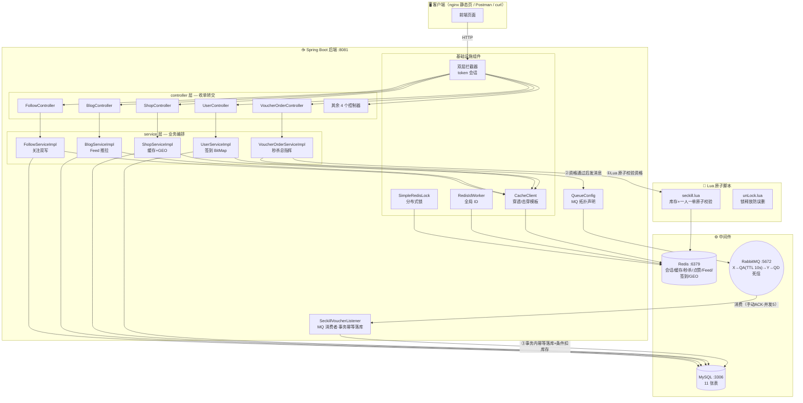
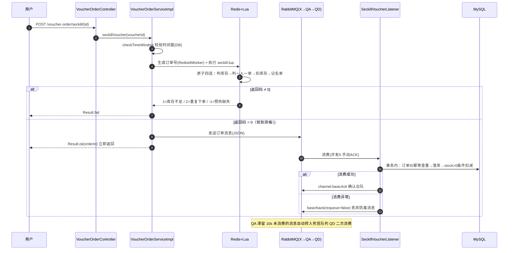

<div align="center">

# 🛎️ 黑马点评

**一个把 Redis 核心技术逐个落地的仿大众点评后端 —— 探店、秒杀、点赞、关注、Feed 流、签到、附近商铺，全部带并发难题的标准解法**

*Redis in Action: a Dianping-style exploration backend where every hotspot has a named countermeasure*

[](https://www.java.com/)
[](https://spring.io/projects/spring-boot)
[](https://baomidou.com/)
[](https://redis.io/)
[](https://www.rabbitmq.com/)
[](https://redis.io/docs/latest/develop/use/embedded-scripts/)
[](./LICENSE)

[快速开始](#-快速开始) · [架构总览](#%EF%B8%8F-架构总览) · [核心亮点](#-核心亮点) · [项目结构](#-项目结构) · [导读地图](ZHIDAO.md)

</div>

---

## 📦 项目简介

**黑马点评（hm-dianping）** 是黑马程序员 Redis 实战课程的配套项目：一个仿大众点评的探店 App 后端。用户可以查店铺、发探店笔记、点赞、关注博主、抢优惠券秒杀、每日签到、按距离搜附近店铺。

它真正的价值不在"点评业务"本身，而在 **每一个高并发热点都有一个具名的、可跑的解法**：缓存穿透有"空值缓存"，缓存击穿有"逻辑过期+互斥锁重建"，秒杀超卖有"Lua 原子校验"，数据库被打爆有"RabbitMQ 异步削峰+死信兜底"，Feed 流有"推模式收件箱+滚动分页"，月度签到有"BitMap 位运算"……

**这个仓库的特别之处**：全部 75 个源码文件（73 Java + 2 Lua）都带有逐行意图级中文注释——每个分支、每次外部调用、每个关键字段的"为什么存在"都写在代码旁边，像一本带批注的书；配套导航文档 [ZHIDAO.md](ZHIDAO.md) 给出机制地图，[STUDY_CHECKLIST.md](STUDY_CHECKLIST.md) 给出 75 文件全量打勾的精读路线。

> 💡 推荐学习路径：先读 [ZHIDAO.md](ZHIDAO.md) 第 2 章（8 个核心概念）建立心智 → 按 [STUDY_CHECKLIST.md](STUDY_CHECKLIST.md) 三条路径（速览 10h / 主线 16h / 全量 30h）逐文件精读 → JMeter 压测秒杀链路验证零超卖。

---

## ✨ 功能全景

- 🏪 **店铺浏览** — 详情走逻辑过期缓存，类型分页支持 Redis GEO 半径 5000m 按距离排序
- 🎫 **优惠券秒杀** — Lua 原子校验（库存+一人一单）→ RabbitMQ 异步落库 → 死信队列延迟重试兜底
- 📝 **探店笔记** — 发布笔记自动推送进所有粉丝的 ZSet 收件箱（推模式 Feed 流）
- 👍 **点赞与点赞榜** — ZSet 记"谁在何时点赞"，Top5 点赞人按点赞时间排序
- 👥 **关注与共同关注** — MySQL 存关系 + Redis Set 求交集，一次 SINTER 算出共同好友
- 📅 **BitMap 签到** — 每月一个 key 按天置位，位运算统计连续签到天数
- 🔐 **短信登录** — 随机 token + Redis Hash 会话，双层拦截器全路径滑动续期 30 分钟
- 🆔 **全局唯一 ID** — 时间戳 31 位 + Redis 自增序列 32 位，按天分片防溢出
- 🖼️ **图片上传** — UUID + hash 两级目录散列，删除接口防路径穿越

## 🏗️ 架构总览



## 🔥 核心亮点

> 每条亮点 = 问题 → 方案 → 代码落点，面试可按此结构复述。

| # | 高并发难题 | 本项目的解法 | 代码落点 |
|---|---|---|---|
| 1 | **缓存穿透**：恶意查不存在的 id，库被打爆 | 空值缓存：查不到写空串 2min TTL | `CacheClient#queryWithPassThrough` |
| 2 | **缓存击穿**：热点 key 过期瞬间并发全打库 | 逻辑过期 + 10 线程池异步重建 + setnx 互斥锁 | `CacheClient#queryWithLogicalExpire` |
| 3 | **秒杀超卖**：查-扣两步之间插入并发 | Lua 脚本原子执行"判库存→判名单→扣减→记名" | `seckill.lua` + `VoucherOrderServiceImpl` |
| 4 | **数据库打爆**：瞬时下单洪峰直接砸库 | RabbitMQ 削峰：资格通过才入队，消费端按节奏落库 | `QueueConfig` + `SeckillVoucherListener` |
| 5 | **消息可靠性**：消费失败/队列滞留怎么兜底 | QA 队列 TTL 10s + 死信队列 QD 延迟重试；手动 ACK/NACK | `QueueConfig#queueA` / `handleOrder` |
| 6 | **重复消费**：MQ 至少一次投递导致重复落库 | 事务内订单 ID 查重 + 主键 INPUT 手工订单号 | `SeckillVoucherListener#handleOrder` |
| 7 | **会话共享**：多实例 Session 不互通 | 随机 token + Redis Hash + 双层拦截器滑动续期 | `UserServiceImpl#login` + 双拦截器 |
| 8 | **Feed 流分页错位**：新消息插入打乱页码 | 推模式收件箱 + max/offset 游标滚动分页 | `BlogServiceImpl#saveBlog / quertBlogOfFollow` |
| 9 | **月度签到存储**：31 个布尔值怎么存 | BitMap 按天置位 + 位运算数连续签到 | `UserServiceImpl#sign / signCount` |
| 10 | **附近商铺**：按距离排序搜索 | Redis GEO 半径 5000m + `ORDER BY FIELD` 保序回查 | `ShopServiceImpl#queryShopByType` |
| 11 | **订单号唯一**：自增 ID 泄露销量、分布式冲突 | 时间戳<<32 \| Redis 按天自增序列 | `RedisIdWorker` |
| 12 | **锁误删**：线程 A 超时后误删线程 B 的锁 | 锁值带线程标识，Lua 比对一致才释放 | `SimpleRedisLock` + `unLock.lua` |

### 秒杀时序（本项目最核心链路）



## 🧰 技术栈

| 分类 | 组件 | 版本 | 用途 |
|---|---|---|---|
| 语言/框架 | Java + Spring Boot | 1.8 / 2.3.12.RELEASE | 后端主体 |
| ORM | MyBatis-Plus | 3.4.3 | BaseMapper CRUD + 分页插件 |
| 缓存/会话/计算 | Redis（Lettuce） | 6.x | 会话/缓存/秒杀/点赞/Feed/签到/GEO |
| 分布式组件 | Redisson | 3.13.6 | 分布式锁客户端（已配置，作演进对照） |
| 消息队列 | RabbitMQ (starter-amqp) | Spring AMQP | 秒杀异步下单 + 死信队列 |
| 原子脚本 | Redis Lua | — | 秒杀资格校验 / 锁释放 |
| 工具库 | Hutool | 5.7.17 | Bean 拷贝/正则/格式化 |
| 数据库 | MySQL | 8.0.28 | 唯一持久层（11 张表） |

## 🚀 快速开始

### 0️⃣ 环境要求

| 组件 | 版本 | 默认地址 |
|---|---|---|
| JDK | 1.8 | — |
| Maven | 3.6+ | — |
| MySQL | 8.0 | 127.0.0.1:3306 |
| Redis | 5.0+ | 127.0.0.1:6379 |
| RabbitMQ | 3.8+ | localhost:5672（管理台 15672） |

### 1️⃣ 初始化数据库

```bash
# 建库建表 + 灌测试数据（脚本自带建库）
mysql -uroot -p你的密码 < src/main/resources/db/hmdp.sql
```

### 2️⃣ 中间件就位（Docker 一把梭，或用本机服务）

```bash
docker run -d --name hmdp-redis -p 6379:6379 redis:6.2
docker run -d --name hmdp-rabbitmq -p 5672:5672 -p 15672:15672 rabbitmq:3.8-management
```

### 3️⃣ 修改配置

编辑 `src/main/resources/application.yaml`：MySQL 密码（默认 290390）、Redis/RabbitMQ 地址按需改。

### 4️⃣ 编译启动

```bash
mvn clean package -DskipTests

# 方式一：IDE 直接跑 HmDianPingApplication#main
# 方式二：命令行
java -jar target/hm-dianping-0.0.1-SNAPSHOT.jar
```

启动成功标志：控制台打印 `秒杀优惠券缓存预热完成，共 N 个，实际写入 M 个`。

### 5️⃣ 体验核心链路

```bash
# ① 发验证码（验证码打印在后端日志里）
curl -X POST "http://localhost:8081/user/code?phone=13800138000"

# ② 登录拿 token（响应 data 即 token，code 填日志里的验证码）
curl -X POST "http://localhost:8081/user/login" \
     -H "Content-Type: application/json" \
     -d '{"phone":"13800138000","code":"123456"}'

# ③ 查店铺详情（走逻辑过期缓存链路）
curl "http://localhost:8081/shop/1" -H "authorization: 上一步的token"

# ④ 秒杀下单（核心链路！第二次会返回"不能重复下单"）
curl -X POST "http://localhost:8081/voucher-order/seckill/券id" \
     -H "authorization: 上一步的token"

# ⑤ 签到 + 连续签到统计（BitMap）
curl -X POST "http://localhost:8081/user/sign" -H "authorization: 上一步的token"
curl "http://localhost:8081/user/sign/count" -H "authorization: 上一步的token"
```

### 6️⃣ 压测验证（简历素材）

JMeter 对 `POST /voucher-order/seckill/{id}` 开 200 并发 / 100 库存：验证**恰好 100 单、每人最多 1 单、tb_voucher_order 表零重复**。

## 📁 项目结构

```
黑马点评/
├── pom.xml                       # Maven 构建：Spring Boot 2.3.12 全家桶 + RabbitMQ + Redisson
└── src/main/
    ├── resources/
    │   ├── application.yaml      # 8081 端口 / MySQL dingping 库 / RabbitMQ 手动 ACK
    │   ├── seckill.lua           # ⭐ 秒杀资格原子校验（库存+一人一单）
    │   ├── unLock.lua            # ⭐ 分布式锁释放（比对线程标识）
    │   ├── db/hmdp.sql           # 建库脚本：11 张表 + 测试数据
    │   └── mapper/VoucherMapper.xml  # 查店铺优惠券 LEFT JOIN 秒杀表
    └── java/com/hmdp/
        ├── HmDianPingApplication.java  # 🚀 启动类
        ├── config/               # ⚙️ 双层拦截器注册 / MQ 拓扑 / Redisson / 分页插件 / 全局异常
        ├── controller/           # 🚪 9 个入口收单
        ├── service/              # 🧠 业务编排（接口 10 + 实现 10）
        ├── mapper/               # 💾 BaseMapper 数据访问（10 接口）
        ├── entity/               # 📦 10 个表实体
        ├── dto/                  # 📨 Result/UserDTO/LoginFormDTO/ScrollResult
        ├── interceptor/          # 🛂 双层登录拦截器
        ├── listener/             # ⭐ MQ 消费者（事务幂等落库）
        └── utils/                # 🧰 CacheClient/RedisIdWorker/SimpleRedisLock/UserHolder…
```

**逐文件深度导读见 [ZHIDAO.md](ZHIDAO.md) —— 每个文件的作用/阅读顺序/要点都在那里。**

## 🗺️ 学习路线与文档导航

| 文档 | 定位 | 适合谁 |
|---|---|---|
| [ZHIDAO.md](ZHIDAO.md) | 项目地图：10 章机制详解 + 三张流程图 + Redis key 总表 | 要通读源码的你 |
| [STUDY_CHECKLIST.md](STUDY_CHECKLIST.md) | 逐页书签：75 文件全量打勾 + 三条精读路径 + 每步自检题 | 按清单推进的学习者 |
| [Description.md](Description.md) | 中英双版项目名片（可直接贴 GitHub About / 简历） | 展示与投递 |

### Roadmap

- [x] 短信登录（token + Redis Hash + 双层拦截器）
- [x] 商铺缓存（穿透/击穿双方案 + 先库后删）
- [x] 优惠券秒杀（Lua + RabbitMQ + 死信队列 + 幂等落库）
- [x] 点赞/共同关注/Feed 推拉/BitMap 签到
- [x] 全源码逐行意图级中文注释 + 三份导航文档
- [ ] 评论功能（BlogComments 空壳已预留）
- [ ] Redisson 看门狗替换手写锁
- [ ] 延迟消息插件替换 TTL 死信方案

## 🤝 参与贡献

1. Fork 本仓库 → 2. 新建分支 → 3. 提交改动 → 4. 发起 Pull Request

## 📄 License

[MIT](./LICENSE) © 2026 Weather-Report
